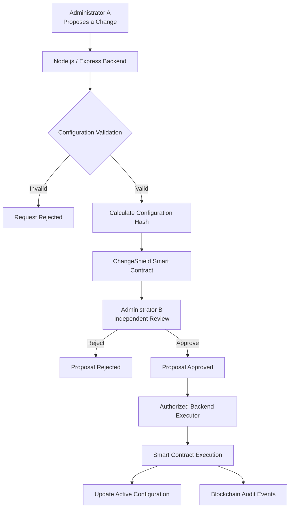

# ChangeShield

### Blockchain-Based Security Configuration Change Governance

**A two-person authorization and tamper-evident audit framework for critical security configuration changes.**

ChangeShield is a blockchain-backed prototype designed to introduce accountability and controlled authorization into sensitive security configuration changes. It uses a two-person approval workflow in which one administrator proposes a change and another independently reviews and approves or rejects it.

Smart contracts enforce the authorization and proposal lifecycle, while a Node.js backend validates configuration changes, coordinates blockchain transactions, and updates the active configuration only after successful on-chain execution.

---

## Overview

In systems that manage sensitive security settings, allowing a single administrator to initiate and authorize a change can create opportunities for misuse, unauthorized modifications, or accidental configuration changes.

ChangeShield addresses this challenge through a structured governance workflow:

- **Separation of duties:** The administrator who creates a proposal cannot approve their own request.
- **Smart-contract authorization:** Critical proposal operations are governed by Solidity-based access controls.
- **Configuration integrity:** Cryptographic hashes are used to verify the proposed configuration.
- **Time-bound proposals:** Pending changes have an expiry deadline.
- **Controlled execution:** Approved changes are executed through a designated backend executor.
- **Auditability:** Important operations are recorded through blockchain events.

The project currently runs as a local prototype using a Hardhat development blockchain.

## Key Features

| Feature | Description |
|---|---|
| Two-person authorization | Requires a separate administrator to approve a proposed change. |
| Role-based access control | Restricts sensitive operations to authorized blockchain accounts. |
| Configuration validation | Checks proposed settings and rejects unsupported or invalid values. |
| Hash verification | Verifies the proposed configuration against its approved cryptographic hash. |
| Proposal lifecycle | Supports Pending, Approved, Rejected, Executed, and Expired states. |
| Automatic expiry | Periodically checks and expires overdue proposals. |
| Controlled execution | Applies configuration changes only after successful blockchain execution. |
| Blockchain audit trail | Records important administrative and proposal events. |
| Transaction management | Serializes backend executor transactions to reduce nonce conflicts. |

## System Architecture

ChangeShield consists of three main layers.

### 1. Smart Contract Layer
**Solidity · Hardhat**

- Maintains administrator and executor permissions.
- Registers configuration-change proposals.
- Enforces independent approval.
- Controls proposal rejection, expiry, and execution.
- Verifies configuration hashes.
- Emits events for important operations.

### 2. Backend Layer
**Node.js · Express.js · ethers.js**

- Provides REST API endpoints.
- Validates incoming configuration-change requests.
- Computes cryptographic configuration hashes.
- Coordinates administrator and executor transactions.
- Updates the active configuration after confirmed execution.
- Monitors proposal expiry.
- Retrieves blockchain audit events.

### 3. Configuration and Metadata Layer
**JSON · Local Hardhat Blockchain**

- `config.json` stores the active demonstration configuration.
- `changes.json` stores supplementary proposal information off-chain.
- The blockchain stores proposal state, configuration hashes, and transaction events.

### Architecture Diagram



## How It Works

The configuration-change lifecycle follows these steps:

1. **Proposal creation:** Administrator A submits a change request with a reason, proposed settings, and validity period.
2. **Backend validation:** The backend checks whether the requested settings and values are permitted.
3. **Hash generation:** A cryptographic hash is calculated for the complete proposed configuration.
4. **On-chain registration:** The proposal and its hash are registered through the ChangeShield smart contract.
5. **Independent review:** Administrator B reviews the request and approves or rejects it.
6. **Controlled execution:** If approved, the designated backend executor submits the execution transaction.
7. **Configuration update:** The backend updates `config.json` only after successful blockchain execution.
8. **Audit recording:** The corresponding blockchain events remain available for audit.

If a proposal is rejected or expires, it cannot proceed through the normal execution workflow.

## Demonstration Scenarios

The application includes four demonstration scenarios to illustrate the governance and validation mechanisms.

| Scenario | Demonstration | Expected Result |
|---|---|---|
| 1. Successful change | A proposal is created, independently approved, and executed. | Configuration updated and execution recorded on-chain. |
| 2. Administrator rejection | A second administrator rejects a pending proposal. | Proposal marked Rejected; configuration remains unchanged. |
| 3. Automatic expiry | A proposal remains pending or approved beyond its validity period. | Proposal automatically marked Expired. |
| 4. Invalid configuration | A request contains an unsupported configuration parameter. | Request rejected before blockchain proposal creation. |

These scenarios demonstrate both successful authorization and the system's ability to prevent invalid or unauthorized configuration changes.

## Technology Stack

| Layer | Technologies |
|---|---|
| Smart Contracts | Solidity 0.8.34 |
| Blockchain Development | Hardhat 3 |
| Backend Runtime | Node.js |
| API Framework | Express.js |
| Blockchain Integration | ethers.js 6 |
| Testing | Mocha, Chai, Hardhat |
| Frontend | HTML, CSS, JavaScript |
| Configuration Storage | JSON |
| Development Environment | Visual Studio Code |

## Project Structure

```text
ChangeShield/
│
├── contracts/
│   └── ChangeShield.sol
│
├── scripts/
│   └── deploy-changeshield.ts
│
├── test/
│   └── ChangeShield.ts
│
├── backend/
│   ├── server.mjs
│   ├── public/
│   │   ├── index.html
│   │   ├── styles.css
│   │   └── app.js
│   └── data/
│       └── config.json
│
├── Run-ChangeShield-Demo.ps1
├── hardhat.config.ts
├── package.json
├── package-lock.json
├── tsconfig.json
├── .gitignore
└── README.md
```

**Generated locally when the application is deployed or run:**

- `artifacts/` and `cache/` — generated Hardhat build files.
- `deployments/local.json` — local deployment information.
- `backend/data/changes.json` — supplementary proposal metadata.
- `.env` — local environment configuration.
- `node_modules/` — installed dependencies.

These local files are excluded from version control where appropriate.

## Getting Started

### Prerequisites

Install the following before setting up the project:

- Node.js 22.13 or later
- npm
- Git
- Visual Studio Code (recommended)

### 1. Clone the Repository

```powershell
git clone https://github.com/Kbansheen/ChangeShield-Blockchain-Security-Governance.git
```

Navigate to the project directory:

```powershell
cd ChangeShield-Blockchain-Security-Governance
```

### 2. Install Dependencies

```powershell
npm install
```

### 3. Build the Smart Contracts

```powershell
npx hardhat build
```

### 4. Run the Test Suite

```powershell
npx hardhat test
```

The test suite contains 10 smart-contract tests covering proposal creation, independent approval, access restrictions, hash verification, rejection, execution, and expiry.

## Local Environment Configuration

Create a `.env` file in the project root.

```dotenv
RPC_URL=http://127.0.0.1:8545
PORT=3000

ADMIN_A_PRIVATE_KEY=
ADMIN_B_PRIVATE_KEY=
EXECUTOR_PRIVATE_KEY=
```

Populate the three private-key variables with the corresponding local development account keys.

The accounts must match the addresses registered in `deployments/local.json`.

> **Security warning:** Use only local Hardhat development accounts for this demonstration. Their default private keys are publicly known. Never use these keys with real funds or on a live network. Never commit your `.env` file or expose private keys in screenshots or documentation.

## Running ChangeShield Locally

The application requires a local blockchain, a deployed smart contract, and the backend server.

### Terminal 1 — Start the Local Blockchain

```powershell
npx hardhat node
```

Keep the blockchain terminal running.

### Terminal 2 — Deploy the Smart Contract

Deploy the contract using the local network configuration:

```powershell
npx hardhat run scripts/deploy-changeshield.ts --network localhost
```

The deployment script deploys the ChangeShield contract, registers the second administrator, and generates:

```text
deployments/local.json
```

This file contains the local contract address, network information, and administrator and executor addresses required by the backend.

The `localhost` network is configured in `hardhat.config.ts` to connect to the local Hardhat JSON-RPC node at `http://127.0.0.1:8545` (chain ID `31337`). It uses the unlocked development accounts provided by the running Hardhat node (`accounts: "remote"`). This setup was verified by successfully deploying ChangeShield with the command above.

### Terminal 3 — Start the Backend

```powershell
node .\backend\server.mjs
```

The backend starts at:

```text
http://127.0.0.1:3000
```

Open the same address in your browser to access the ChangeShield dashboard.

### Important Runtime Notes

- Keep the local blockchain running while using the dashboard.
- The backend depends on the deployed contract information and generated Hardhat artifacts.
- Restarting the Hardhat node resets its local blockchain state.
- After a reset, redeploy the contract and restart the backend with the updated deployment information.
- `Run-ChangeShield-Demo.ps1` is an optional script for automating demonstration scenarios; it is not required to launch the dashboard.

## Backend API Reference

The Express backend exposes the following endpoints:

| Method | Endpoint | Purpose |
|---|---|---|
| `GET` | `/api/health` | Check backend and blockchain connectivity. |
| `GET` | `/api/config` | Retrieve the active configuration. |
| `GET` | `/api/changes` | Retrieve all configuration-change proposals. |
| `GET` | `/api/changes/:id` | Retrieve a specific proposal. |
| `POST` | `/api/changes` | Submit a new configuration-change proposal. |
| `POST` | `/api/changes/:id/approve` | Approve a pending proposal. |
| `POST` | `/api/changes/:id/reject` | Reject a pending proposal. |
| `POST` | `/api/changes/:id/execute` | Execute an approved proposal. |
| `POST` | `/api/changes/:id/expire` | Expire an overdue proposal. |
| `GET` | `/api/audit` | Retrieve blockchain audit events. |

### Example Proposal Request

```json
{
  "reason": "Reduce the permitted number of failed login attempts",
  "validForSeconds": 3600,
  "patch": {
    "maxLoginAttempts": 3
  }
}
```

### Supported Configuration Parameters

| Parameter | Data Type | Permitted Values |
|---|---|---|
| `requireMFA` | Boolean | `true` or `false` |
| `maxLoginAttempts` | Integer | 1–20 |
| `firewallMode` | String | `standard`, `strict`, `restricted` |

Unsupported parameters and invalid values are rejected by the backend before a blockchain proposal is created.

## Smart Contract Events

The ChangeShield contract emits events to provide a traceable record of important operations.

| Event | Purpose |
|---|---|
| `AdminUpdated` | Records administrator permission changes. |
| `ExecutorUpdated` | Records executor updates. |
| `ChangeProposed` | Records creation of a configuration-change proposal. |
| `ChangeApproved` | Records approval of a proposal. |
| `ChangeRejected` | Records rejection of a proposal. |
| `ChangeExpired` | Records expiry of a proposal. |
| `ChangeExecuted` | Records successful execution. |

The backend retrieves these events through the `/api/audit` endpoint.

## Testing

The smart-contract test suite validates the principal authorization and proposal lifecycle rules.

It covers:

1. Successful proposal creation by an administrator.
2. Prevention of self-approval.
3. Approval by a different authorized administrator.
4. Rejection of proposals from unauthorized accounts.
5. Configuration hash mismatch prevention and valid execution.
6. Prevention of unauthorized approval.
7. Independent proposal rejection.
8. Prevention of unauthorized execution.
9. Prevention of repeated execution.
10. Proposal expiry after its deadline.

Run the tests with:

```powershell
npx hardhat test
```

## Security Scope and Current Limitations

ChangeShield is an academic working prototype intended to demonstrate blockchain-backed governance for critical configuration changes.

The current implementation has the following scope and limitations:

- The blockchain records proposal state, configuration hashes, authorization actions, and execution events.
- The active configuration and supplementary proposal metadata are maintained off-chain.
- Authorization is based on configured blockchain accounts and backend-held signing keys.
- The current prototype does not provide production-grade independent human authentication or a complete enterprise identity-management system.
- The demonstration configuration is a local JSON file; the project does not directly modify a real firewall, cloud infrastructure, or production authentication service.
- Blockchain records provide a tamper-evident transaction history, but do not independently prove that an external production system applied a configuration successfully.

A production deployment would require stronger key management, independently authenticated administrator approvals, secure API access, persistent storage, operational monitoring, and integration with actual configuration-management infrastructure.

## Future Enhancements

Potential extensions include:

- Wallet-based independent administrator signing.
- Stronger administrator identity verification and authentication.
- Database-backed proposal and metadata management.
- Integration with real cloud and security configuration systems.
- Expanded audit reporting and transaction receipt views.
- Additional security testing and performance evaluation.

## Project Objective

ChangeShield explores how blockchain technology and smart-contract-based authorization can strengthen the governance of sensitive security configuration changes.

By combining independent administrative approval, cryptographic integrity verification, controlled execution, and blockchain-backed audit records, the project demonstrates a structured approach to improving accountability and reducing the risk of unilateral configuration changes.

---

**Developed as an academic project in Blockchain and Cybersecurity.**
